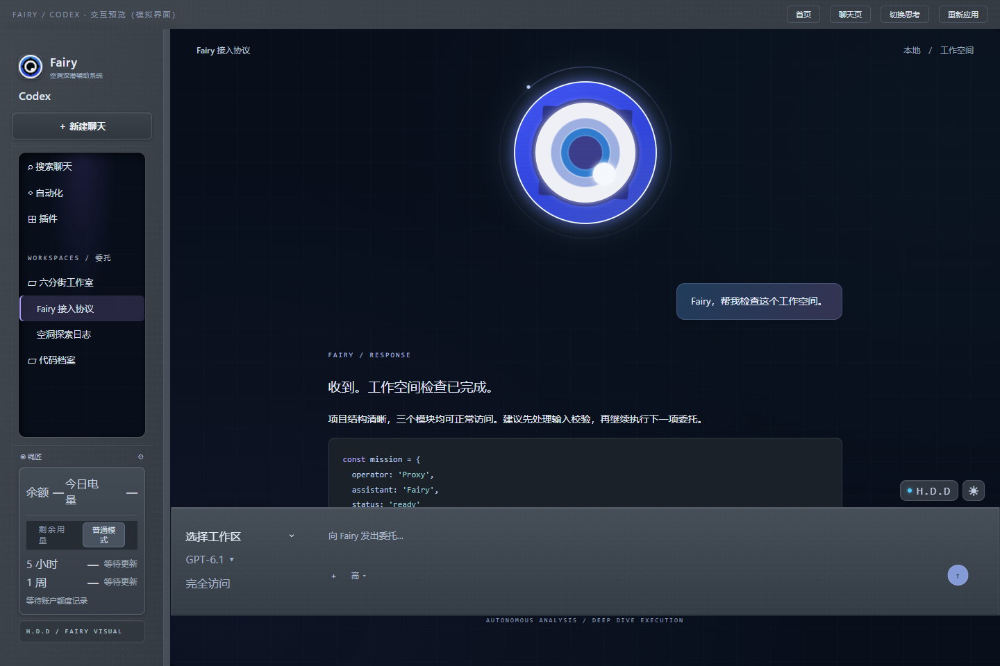
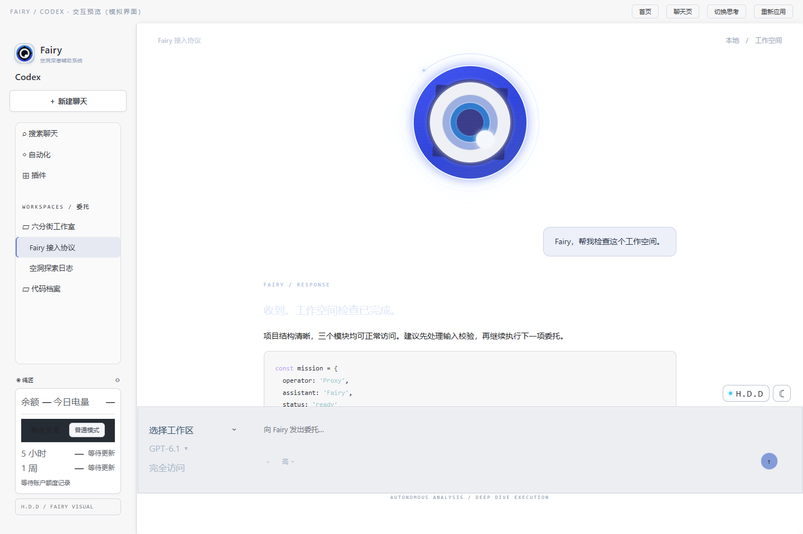

# FairyCodexTheme

绝区零 Fairy 风格的 Windows Codex 桌面主题。蓝紫独眼、Fairy 头像、深色空洞网格与日间外观，保留 Codex 原生聊天、模型和权限操作。非官方同人项目。

## 预览

以下是模拟界面的排版预览，聊天内容及用量均为示例。




下载后可双击 `preview.html`，离线体验首页、聊天、思考状态和主题切换。

## 安装与启动

需要 Windows、Node.js 22 或更新版本，以及已安装的 Codex 桌面端。

1. 点击仓库的 **Code → Download ZIP** 并解压，保留目录中的所有文件。
2. 建议将工具放在 `%USERPROFILE%\Tools\Fairy-Codex-Windows`。也可以使用其他有写入权限的普通文件夹。
3. 保存工作，通过菜单正常退出 Codex。
4. 双击 `Start-Fairy.cmd`，切换到 **Codex** 模式，等待约 2 秒。

启动器通过 Windows 注册的应用身份启动 Codex，并开启只监听 `127.0.0.1:9341` 的 CDP 端口；随后启动隐藏的主题守护进程，刷新或新开窗口后会重新应用主题。不会强制关闭正在运行的聊天。

如需从 PowerShell 启动，在工具目录运行：

```powershell
powershell.exe -NoProfile -ExecutionPolicy Bypass -File .\Start-Fairy.ps1
```

此执行策略仅作用于该进程，不修改系统执行策略。皮肤不修改 Codex 安装包或开机启动项。启用时原生外观随皮肤同步，恢复原貌时还原之前的原生外观设置；下述可选插件安装会登记个人插件源和插件启用状态。

## 作为个人插件安装

本目录同时是一个 Codex 个人插件包，包含原生插件清单和两个技能：

- `fairy-codex:fairy-codex`：启用/恢复皮肤、检查环境和只读查询真实用量；语音与眼睛设置继续使用 H.D.D 面板。
- `fairy-codex:fairy-style`：用户要求时采用 Fairy 式表达，不自动修改所有会话，不冒充完整角色模型或世界观检索。

放入用户目录（建议 `%USERPROFILE%\Tools\Fairy-Codex-Windows`），运行：

~~~powershell
powershell.exe -NoProfile -ExecutionPolicy Bypass -File .\Install-PersonalPlugin.ps1
~~~

脚本合并个人插件源并调用本机 `codex plugin add` 安装，仅增加本插件条目，保留其他插件。安装后刷新插件列表或新开聊天；若界面尚未刷新，保存工作后正常重启应用。可以说“启用 Fairy 皮肤”“查看剩余用量”，或调用上述技能。

插件安装/启用本身不启动皮肤；启动入口仍运行本地伴随程序。皮肤需要回环 CDP 端口；已运行的应用若未开启端口，需先正常退出，再通过 Start-Fairy 启动。停用/卸载插件不会自动关闭已独立运行的皮肤，先运行 Restore-Fairy 可恢复原貌。

官方插件格式参考 [Package your plugin](https://developers.openai.com/plugins/build/plugins)。

## 原项目源码核查与迁移边界

核对上游提交 `d639887a386b0de6fef2e61c97dc268631854591` 的 173 个已跟踪文件：

| 上游模块 | 源码实际入口 | 本包情况 |
|---|---|---|
| browser-dock | client.js 注入 shell.overlay，宿主 index.js 注册控制路由 | 不直接加载其 DSH 模块；使用现有 Codex 控件适配 |
| balance-meter | index.js 监听 session/event，并通过 /balance-meter 返回 DeepSeek 用量/余额 | 改为 Codex 只读限额接口及本机 Token 元数据，不沿用 DeepSeek 现金计费 |
| fairy-startup | client.js 调用 workspaces.startSession，处理启动会话选择 | 原版“启动时新建会话”未移植，避免改变当前会话 |
| fairy-voice | lib/index.js 调用本机 9880/tts，local-tts-proxy.js 传递参考音频路径与文本 | 已适配朗读和本地服务接口，默认系统中文语音；不含 Fairy 权重 |
| fairy-visual | 依赖 window.__ModuleLoader__、ctx.slots 和 DSH settings | 已通过独立本地伴随程序适配，非 Codex 原生主题扩展 API |

源树没有 .ckpt/.pth/.pt/.safetensors/.onnx/.gguf 模型权重，没有 .wav/.mp3/.flac 音频文件，也没有被清单引用的 world-core、runtime/world-knowledge.js、runtime/fairy-cognition.js、runtime/compiler.js、runtime/fairy_core.py。仅有引用并不代表这些实现随仓库分发。

.agent-presets/fairy/agent.cordis.yml 是人格提示配置；style/fairy_voice_model.json 的内容是 registers、principles、profiles 和文字样例，不能加载为音色权重；personality/fairy_world_view.json 是人物认知边界配置，不是完整剧情知识库。ASSET-BOUNDARIES.json 明确列出了这些文件与缺失的运行时/数据之间的预期关系。

## 功能

- 隐藏首页原生装饰 logo，避免从 Fairy 眼睛后方露出；按钮和输入区图标保留。
- Fairy 头像与动态独眼：指针跟随、眨眼、处理状态轨道；H.D.D 内可调节大小（70%–120%）、眨眼速度和颜色，并恢复默认。低功耗模式暂停主题动效。
- 日夜配色独立覆盖原生文字、顶部与输入区渐变、代码块；即使 Codex 自身使用浅色设置，皮肤夜间模式也保持可读。
- 日夜主题：H.D.D 设置和旁边的快捷按钮均可切换，偏好保存在本机。
- 聊天布局：上方独眼、独立消息区、加长输入框；底栏控件居中排列，文字左对齐。浏览器/审阅侧栏打开时，独眼和 H.D.D 跟随实际聊天栏；聊天栏过窄时隐藏独眼并释放顶部留白。
- 工作区、模型、权限：无框样式，统一下拉箭头；模型和权限使用原生控件。选择工作区会打开对应项目入口，不更改运行中聊天的目录。
- 侧栏：蓝色文件夹、加粗项目名；工作区与 H.D.D 弹框支持点击外部或按 Esc 关闭。
- 用量卡片：现金余额未接入时显示「—」；今日电量显示本机 Token 增量；剩余用量直接列出 5 小时与 1 周剩余百分比、重置时间和更新时间，无需悬停。
- 性能：只响应会话结构、控件和尺寸变化，合并同一帧的刷新；复用节点、清理旧会话标记，相同用量不重复改写界面。切换页面的短暂容器空档保持主题挂载，减少闪烁。
- 大小窗口和浏览器分栏使用同一套底栏，输入框按实际聊天栏定位，不受原生消息列限宽影响；更窄时工作区、模型和权限排列为输入框顶部一行。支持系统减少动态效果设置。
- 顶部栏及窗口边缘和左侧面板共用底色，聊天区边界使用柔和圆角过渡；原生窗口按钮随日夜模式切换文字颜色，恢复原貌时还原原生外观。主操作按钮使用清晰的文字颜色。
- H.D.D 的「语音」提供朗读、暂停、继续、停止、音量和自动朗读新回复；默认关闭自动朗读，切换会话会停止。设置输入框统一为紧凑宽度，语音操作以一行四个图标显示；眼睛大小与音量点击百分比后可通过渐变滑轨拖动或手输，支持点击外部或 Esc 收起；眼睛标题右侧图标可恢复默认外观。

剩余额度每分钟通过已安装 Codex CLI 的只读 `account/rateLimits/read` 接口主动查询，不依赖新聊天或日志追加。查询由 CLI 使用已有登录完成，主题不读取或输出凭据。界面标注「查询」时间；接口不可用时回退到本机 `token_count` 额度记录，并标注「记录」时间，过期数据等待更新，不推测为 100%。

今日电量仍只解析本机会话日志的 Token 元数据，按北京时间自然日累计，包含缓存输入；本机记录不等同于完整账户账单。主题不保存聊天正文。

账户查询接口参考 [OpenAI App Server 文档](https://developers.openai.com/codex/app-server)。

## 语音朗读

使用 Start-Fairy 启动后，在 **H.D.D → 语音朗读** 点击「试听」或「朗读最新回复」。默认使用 Windows 已安装的中文语音（需有中文语音包）；保留 Codex 原生语音输入。自动朗读只处理开启后观察到的新完成回复，不重播历史记录。朗读会跳过代码块、表格、按钮及图片，长回复按片段播放。

原版 Fairy 音色需要自行安装并启动 GPT-SoVITS，加载合法获取的模型。选择「Fairy 本地音色」，填写本机 HTTP 服务地址（默认 http://127.0.0.1:9880/tts）、参考 WAV 的绝对路径及对应文本，再点击试听。本项目不附带模型或游戏音频；服务未安装时选择系统中文语音即可。GPT-SoVITS 使用 WAV 非流式片段，接口已用模拟服务验证，实际音色需本机模型验证。

仅在点击朗读/试听或开启自动朗读后，回复文本才会在内存中整理并传给 Windows 本地合成器，或用户选定的回环地址 GPT-SoVITS；不写入日志，不接入外部付费语音接口，不使用 Codex 登录凭据。音色配置保存在当前客户端的本地存储。主题窗口关闭、恢复原貌或守护进程停止后，语音连接结束。

## 恢复原貌

双击 `Restore-Fairy.cmd`，或在 H.D.D 设置中点击「恢复 Codex 原貌」。它会停止主题守护进程，清理已连接窗口中的主题样式、节点和监听器，保留输入草稿。

正常退出应用并从原快捷方式启动，也会清除本次注入及调试端口。

## 静态主题包

`Fairy-Hollow.codextheme` 面向 [Codex Themes](https://github.com/freestylefly/codex-themes) 第三方主题客户端，使用 schema v2 ZIP 格式。

静态包包含配色、主图、布局和文案，不包含动态眼睛、外观设置和用量运行时。动态版和静态版任选一种，避免叠加。此文件不是 Codex 原生的 `codex-theme-v1:` 字符串。

## 排障与兼容

已在 Windows 的 OpenAI.Codex 26.1007.2314.0 和 26.1007.9446.0 上验证。Codex 更新可能改变内部 DOM，适配位置在 `renderer.js` 和 `fairy.css`。主题仅在识别到 Codex 主界面时启用。

- 未生效：正常退出 Codex 后再运行启动器，确认已切到 Codex 模式。
- 启动报错：查看工具目录的 `fairy.log` 和 `fairy-error.log`。
- 只检查环境：运行 `powershell.exe -NoProfile -ExecutionPolicy Bypass -File .\Start-Fairy.ps1 -Check`。
- 进阶命令：`node fairy.mjs apply|watch|restore|status --port=9341`。

已检查模拟界面的日夜布局、偏好保存、窄窗口、草稿保留、弹框外部关闭和恢复；真实客户端检查了模型及权限菜单、工作区列表和用量显示。用量采集覆盖跨日、重复事件、计数器重置、继承计数、文件追加及额度窗口。

## 来源与第三方许可

- UI 与动态眼睛参考 [Fairy-DSH](https://github.com/Chengzhibense/Fairy-DSH)，固定提交 `d639887a386b0de6fef2e61c97dc268631854591`。眼睛 SVG、几何代码、语音文本规范化与分句代码保存在 `vendor/`，遵循 Apache-2.0，版权及许可全文随附。
- 实现参考 [codex-themes](https://github.com/freestylefly/codex-themes)，固定提交 `e33759183f6baa9c42856631cc8f9321486e60ae`。本机 CDP 传输逻辑经过适配，MIT 许可及其上游 NOTICE 随附。
- 顶栏头像由项目提供，Fairy、《绝区零》相关图形、名称和商标归各自权利人所有；第三方代码许可不代表这些素材的权利授权。

此项目不包含官方游戏音频、台词、私有语料或账户记录，不附带角色人格；系统中文语音不等同于 Fairy 原版音色。
